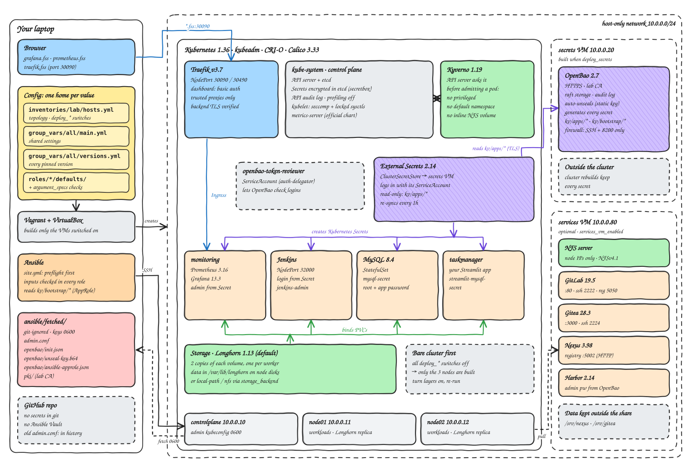

# Kubernetes-FAC

A reproducible Kubernetes lab for VirtualBox: provision the VMs with Vagrant, then run individual Ansible roles from Kuboos templates or with role-specific tags.

## Overview

Kubernetes-FAC creates a private-network Kubernetes environment that is useful for learning, demonstrations, and platform experiments. The base topology is a control plane and two workers. Run each role explicitly with its dedicated Ansible tag; optional VM settings describe topology only.

> [!NOTE]
> The lab is intentionally configurable and idempotent. Keep generated credentials and kubeconfig files under `ansible/fetched/`; that directory is git-ignored.



## Features

- Kubernetes 1.36 with CRI-O, Calico, Helm, and metrics-server
- Longhorn, local-path, or NFS storage roles
- Kyverno admission policies
- OpenBao-backed secrets with External Secrets Operator
- Traefik ingress, Jenkins, Prometheus, Grafana, and MySQL roles
- GitLab, Gitea, Nexus, and Harbor service roles
- Terminal UI for editing the lab inventory and running deployment commands
- Environment-specific inventories with pinned versions in one location

## Topology

The default `lab` environment creates:

| Host | Role | Address | Resources |
|---|---|---|---|
| `controlplane` | Kubernetes control plane | `192.168.56.10` | 3 vCPU, 3 GB RAM |
| `node01` | Worker | `192.168.56.11` | 2 vCPU, 3 GB RAM |
| `node02` | Worker | `192.168.56.12` | 2 vCPU, 3 GB RAM |

Set `secrets_vm_enabled: true` to create `secrets` at `192.168.56.20`. Set `services_vm_enabled: true` to create `services` at `192.168.56.80`. These are topology settings; they do not select Ansible roles.

The topology is defined in `ansible/inventories/lab/hosts.yml`. Run prerequisite roles before dependent services, as described in [docs/RUNBOOK.md](docs/RUNBOOK.md).

## Prerequisites

On your workstation, install:

- VirtualBox
- Vagrant
- Ansible
- `kubectl`
- `jq`
- Python `passlib` for the Traefik password setup

Install the required Ansible collections:

```shell
ansible-galaxy collection install kubernetes.core community.general community.crypto community.docker
pip install passlib
```

### VirtualBox private network

VirtualBox may restrict host-only networks outside `192.168.56.0/24`. On Linux and macOS, create `/etc/vbox/networks.conf`:

```shell
sudo mkdir -p /etc/vbox
sudo tee /etc/vbox/networks.conf >/dev/null <<'EOF'
* 0.0.0.0/0 ::/0
EOF
```

## Quick start

1. Provision the base cluster:

```shell
VAGRANT_EXPERIMENTAL="disks" vagrant up
```

2. Configure the base cluster:

```shell
cd ansible
ansible-playbook site.yml --tags init
cd ..
```

3. Connect with the generated kubeconfig:

```shell
export KUBECONFIG=$PWD/ansible/fetched/admin.conf
kubectl get nodes
kubectl get pods -A
```

The `init` tag builds the Kubernetes nodes, installs Helm, and installs metrics-server. Other roles use dedicated tags such as `role_storage` and `role_prometheus`.

## Optional features

Set the optional VM topology settings in `ansible/inventories/lab/hosts.yml`, then run `vagrant up` for the VM. Select one role with its dedicated tag:

| Role | Tag |
|---|---|
| Common, control plane, worker, waiting | `role_common`, `role_controlplane`, `role_worker`, `role_waiting` |
| Helm, metrics-server | `role_helm`, `role_metrics_server` |
| Storage, Kyverno | `role_storage`, `role_kyverno` |
| OpenBao, External Secrets | `role_openbao_server`, `role_external_secrets` |
| Traefik, Jenkins, Prometheus, Grafana, MySQL | `role_traefik`, `role_jenkins`, `role_prometheus`, `role_grafana`, `role_mysql` |
| Docker/NFS, GitLab, Gitea, Nexus, Harbor | `role_docker_nfs`, `role_docker_insecure_registry`, `role_gitlab`, `role_gitea`, `role_nexus`, `role_harbor` |

For example: `ansible-playbook ansible/site.yml --tags role_prometheus`. Each tag selects only that role. Install dependencies as separate role runs first; NFS storage requires the services VM to exist.

For step-by-step role order and verification commands, use [docs/RUNBOOK.md](docs/RUNBOOK.md). [The PDF guide](docs/kubernetes-fac-guide.pdf) is a generated snapshot and may not reflect the latest inventory values.

## Configuration

Configuration follows a single-source-of-truth model:

| Purpose | File |
|---|---|
| Nodes, addresses, VM resources, and topology settings | `ansible/inventories/<environment>/hosts.yml` |
| Shared environment settings | `ansible/inventories/<environment>/group_vars/all/main.yml` |
| Pinned Kubernetes, chart, and container versions | `ansible/inventories/<environment>/group_vars/all/versions.yml` |
| Role-specific defaults | `ansible/roles/<role>/defaults/main.yml` |
| Optional TUI configuration | `tui/example-configs.md` |

The `KFAC_ENV` variable selects an inventory environment. It defaults to `lab`:

```shell
KFAC_ENV=lab vagrant up
KFAC_ENV=lab ansible-playbook -i ansible/inventories/lab/hosts.yml ansible/site.yml
```

## Terminal UI

Launch the terminal interface from the repository:

```shell
python3 -m venv .venv
source .venv/bin/activate
pip install -r tui/requirements.txt
python tui/k8s_fac_tui.py
```

The TUI reads and updates the inventory, runs Vagrant and Ansible commands, and checks Kubernetes and VM status. It does not replace the command-line workflow.

See [tui/README.md](tui/README.md) and [tui/SERVICES_REFERENCE.md](tui/SERVICES_REFERENCE.md) for interface and service details.

## Secrets

There are no secrets in Git and no Ansible Vault dependency. OpenBao generates application passwords and exposes them to workloads through External Secrets.

Generated credentials and cluster files are stored under `ansible/fetched/`:

- `openbao/init.json`: OpenBao root token and recovery key
- `openbao/unseal-key.b64`: OpenBao unseal key
- `openbao/ansible-approle.json`: Ansible AppRole credentials
- `kubernetes/etcd-encryption-key.b64`: key required to restore etcd snapshots
- `pki/`: local certificate authority and OpenBao certificates
- `admin.conf`: Kubernetes cluster-admin kubeconfig

> [!WARNING]
> Back up the OpenBao break-glass files and etcd encryption key offline, and keep the kubeconfig private. Losing the unseal key or recovery material prevents recovery of OpenBao secrets; losing the etcd encryption key prevents reading encrypted Kubernetes Secrets from an etcd restore.

Read a secret explicitly for a break-glass operation:

```shell
export BAO_ADDR=https://192.168.56.20:8200
export BAO_CACERT=$PWD/ansible/fetched/pki/ca.crt
export BAO_TOKEN=$(jq -r .root_token ansible/fetched/openbao/init.json)
bao kv get kv/apps/grafana
```

## Common operations

```shell
# Start or recreate VMs
VAGRANT_EXPERIMENTAL="disks" vagrant up

# Configure the base cluster
ansible-playbook ansible/site.yml --tags init

# Apply one role or feature
cd ansible && ansible-playbook site.yml --tags role_kyverno

# Stop or destroy VMs
vagrant halt
vagrant destroy -f

# Check cluster state
export KUBECONFIG=$PWD/ansible/fetched/admin.conf
kubectl get nodes
kubectl get pods -A
```

## Repository layout

```text
.
├── Vagrantfile                 # Inventory-driven VM provisioning
├── ansible/
│   ├── site.yml                # Cluster and platform playbook
│   ├── inventories/lab/        # Lab topology and variables
│   └── roles/                  # Deployment components
├── docs/
│   ├── RUNBOOK.md              # Feature-by-feature operations guide
│   └── architecture/           # Architecture diagrams
└── tui/                        # Terminal management interface
```
